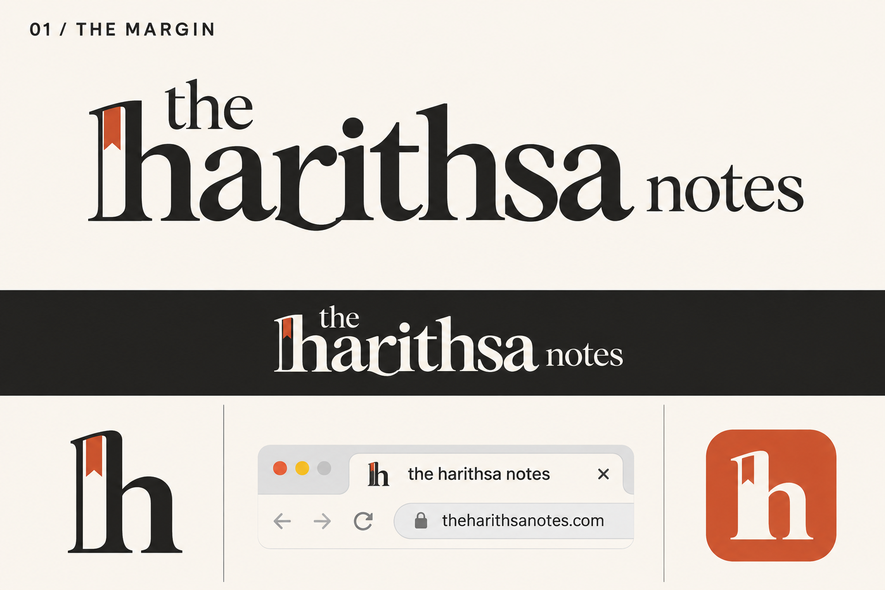
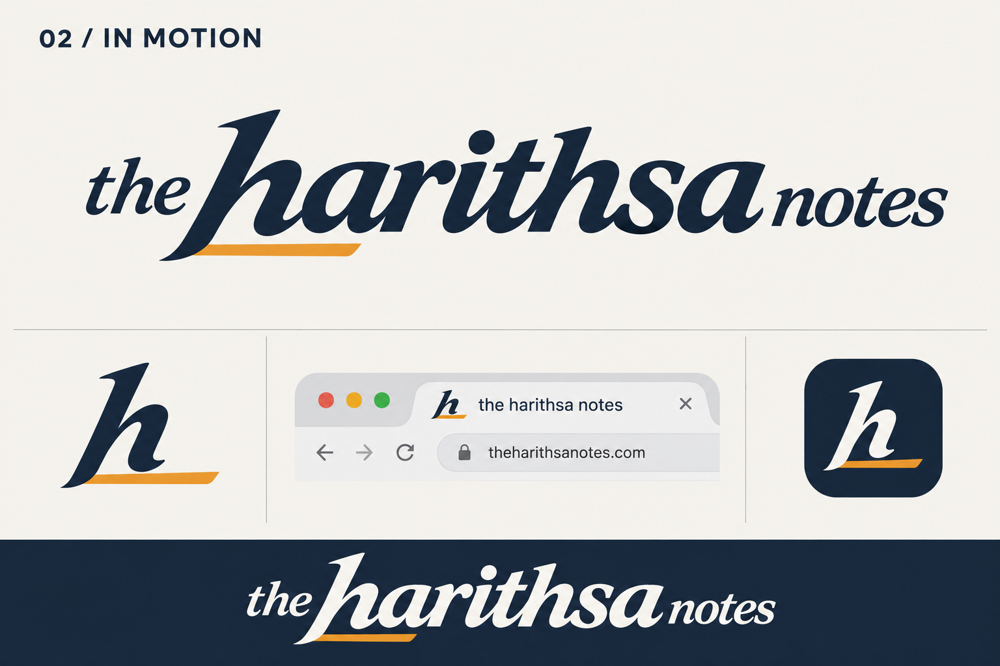

# The Harithsa Notes identity exploration

[Issue #25](https://github.com/theharithsa/theharithsanotes/issues/25). The owner prioritizes freezing a better logo and a coordinated favicon/icon family before the dynamic CMS. Two original directions are presented for selection; neither is approved or installed on the live site.

## 01 — The Margin

A literary identity built around a distinctive lowercase serif wordmark. The compact h carries a bookmark detail, connecting the mark to reading and personal notes without an extra generic book symbol. Warm paper, charcoal and vermilion suit the journal's illustrated editorial design.

Proposed palette: ink `#242321`, paper `#FAF7F0`, vermilion `#C75C3A`. Generated raster colours are illustrative, not exact production colour specifications.

This is the preferred editorial direction: stronger ownership in the bookmark h and a calm counterpart to the site's varied artwork. The small icon will need a heavier optical drawing so the bookmark and serif details survive at 16 pixels.

## 02 — In Motion

A flowing italic identity reflecting the owner's earlier motorsport reference. The short accent beneath the h supplies motion without adding arrows to the navigation. The same h becomes the compact icon. The horizontal wordmark gives the name more room than the current stacked logo.

Proposed palette: midnight `#17263C`, porcelain `#F5F4EF`, gold `#E9A044`. This is the closer match to the earlier Formula One/cursive preference. Simplify the accent and widen the h's counters for the smallest icon sizes.

## What is reviewed, and what is not frozen

Both boards were generated with the built-in image tool and visually inspected for the correct brand wording, distinct direction, full-name and compact-mark relationship, and light/dark use. Original assets and exact prompts are retained in [the generation record](../assets/brand-identity/prompts-v1.json).

The browser fragments are illustrative mockups, not screenshots or favicon test evidence. They contain a generated address different from the real `theharithsa.com`; do not ship those fragments as product assets. Raster edges, gradients and miniature details do not define the final vector geometry. No claim is made that the concepts have been tested at real browser-tab size, are licensed fonts, or have been cleared for trademark registration.

## Freeze package after selection

1. Draw the selected wordmark and optical small h as clean, self-contained SVG paths, with a compact mobile lockup. Avoid font-dependent SVG text and embedding the whole concept board.
2. Define precise geometry, approved colours, clear space, minimum dimensions, monochrome and inverse versions. Keep technical content typography and section palettes intact.
3. Export favicon SVG, multi-size ICO (16/32/48), Apple touch icon (180), application icons (192/512) and maskable variants with safe padding. Coordinate manifest, browser icon references and social branding.
4. Replace the current Wordmark component and favicon in one issue-linked implementation PR. Check header height, menu positioning, home link accessibility, light/dark contrast and narrow mobile layouts.
5. Inspect actual 16/32-pixel browser tabs and installed-icon previews, and verify icon URLs/content types/caching on the preview before production release. Record approved asset hashes and retire superseded references only after that verification.

Selection is pending. Current production logo/favicon remain intact; CMS planning remains separately tracked in issue #23 and PR #24.
