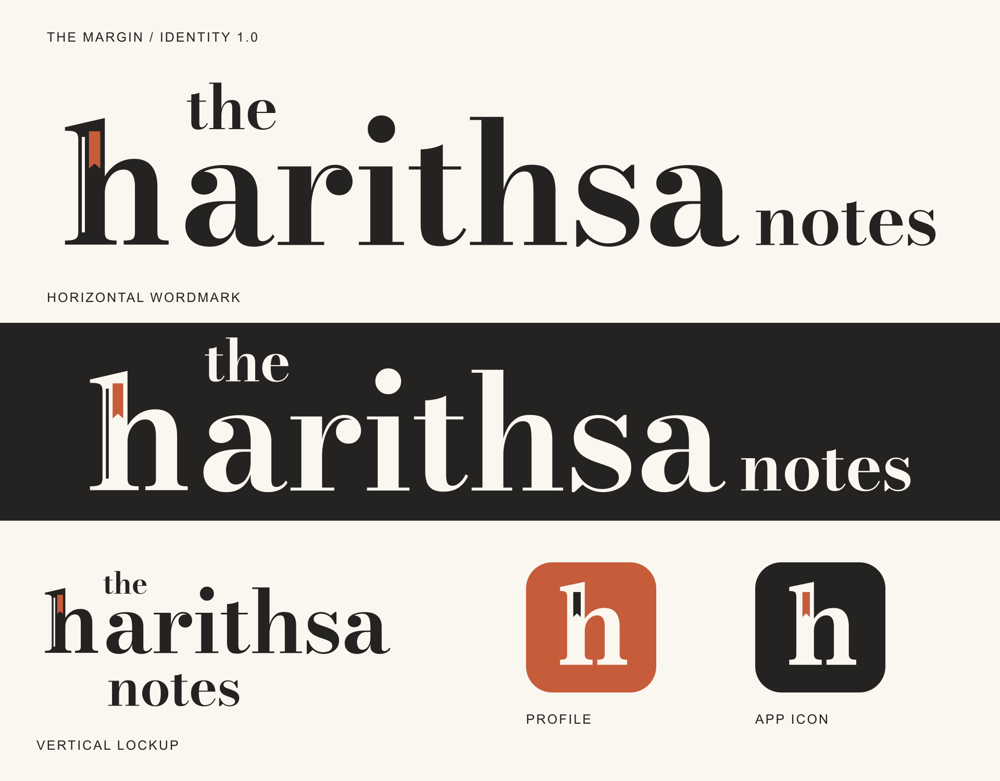

# The Margin — identity 1.0.0

Owner-selected on 6 November 2026. The canonical brand name is **the harithsa notes**. Preserve the lower-case wordmark and integrated bookmark h. The owner's personal portrait remains unchanged.



## Deliverables and usage

Run `python scripts/package-brand.py` to export the complete brand kit to the local, ignored `archives/` directory. Exports live under `public/brand/v1`; [identity.json](../public/brand/v1/identity.json) records asset hashes, geometry ownership and font provenance.

| Use               | Export                                                 | Contract                                                            |
| ----------------- | ------------------------------------------------------ | ------------------------------------------------------------------- |
| Full logo         | `logo-horizontal-{ink,inverse,black,white}.{svg,png}`  | Transparent SVG/3200px PNG; minimum displayed width 136px           |
| Vertical logo     | `logo-vertical-{ink,inverse,black,white}.{svg,png}`    | Stacked name; SVG/2000px PNG; minimum displayed width 120px         |
| Standalone mark   | `mark-{ink,inverse,black,white}.{svg,png}`             | Custom h, bookmark and spine slit; 1024px transparent PNG           |
| Profile picture   | `profile-{1024,512}.png`, `profile.svg`                | Paper h on vermilion, ink ribbon; avatar-safe padding               |
| App icon          | `app-icon-{192,512}.png`, `app-icon.svg`               | Paper h and vermilion ribbon on ink                                 |
| Maskable icon     | `app-icon-maskable-{192,512}.png`                      | Extra padding for platform masks; separate manifest purpose         |
| Apple home-screen | `apple-touch-icon.png`                                 | Opaque 180px icon                                                   |
| Browser tab       | `favicon.svg`, `favicon.ico`, `favicon-{16,32,48}.png` | Optical small mark omits fine slit; ICO has all three sizes         |
| Share preview     | `social-card.{svg,png}`                                | 1200×630 branded card; article-specific covers remain authoritative |

Palette: ink `#242321`, paper `#FAF7F0`, vermilion `#C75C3A`. Transparent inverse/white exports belong on dark backgrounds. Monochrome variants omit the accent distinction. Preserve at least one ribbon-width of clear space, roughly one eighth of mark height. Never stretch, add shadows or recolour the mark per section. Content palettes and technical typography remain independent.

Inline header artwork inherits the site foreground for light/dark themes; the ribbon retains its colour. Logo links carry the accessible home/site label and internal artwork is decorative. Base owns favicon, Apple icon, manifest and generic social metadata. The manifest supplies icons and uses browser display mode; it does not claim offline/PWA functionality.

## Reproduction and freezing

`scripts/generate-brand.py` creates self-contained SVG path masters from the original h and outlined Bodoni Moda lettering at weight 650/optical size 12. The production drawing follows the selected direction; it is not a crop or automatic trace of the concept bitmap. The optical setting strengthens fine strokes at header sizes.

Reviewed font source: `assets/brand-identity/source/BodoniModa.ttf`, SHA256 `550f5e34ee0a828d7941b1fe9bc58b34e5260d3f33a61532e6d0a0114e79a5cf`, Google Fonts blob `c5d582f8003ae692761dd8e9ce69de23cb9fea53`. The [SIL OFL notice](../LICENSES/BodoniModa-OFL.txt) is preserved; [Google Fonts](https://github.com/google/fonts/tree/main/ofl/bodonimoda) owns the source/licence. Final letters are paths with no logo-font download. Racing Sans One is removed from application dependencies.

```powershell
python -m pip install -r scripts/brand-requirements.txt
python -X utf8 scripts/generate-brand.py
node scripts/render-brand.mts
python -X utf8 scripts/package-brand.py
```

The renderer uses the pinned Sharp development dependency. Inspect the sheet, tiny icons, mask safety, alpha and component layout after regeneration. Reproduction updates the hash manifest and deterministic ZIP. Version 1 is the frozen release: future approved geometry changes belong in `v2` with consumer migration rather than overwriting cached versioned artwork.

## Domain and evidence

The owner cancelled the additional `theharithsanotes.com` setup after GoDaddy Portfolio and DNS search showed no matching domain. No registrar records were changed. Both newly created inactive Firebase resources were removed; the subsequent domain list contains only the original apex/www pair. Keep `theharithsa.com` canonical and its existing www redirect intact.

Issue #25/PR #26 own current-head checks, browser screenshots and preview/production receipts. The sheet is artwork, not browser evidence. Check actual 16/32px icons and mobile/desktop light/dark headers before deployment. Anonymous opt-in RUM/GA behavior is preserved; no backend or privileged exporter is introduced. Tenant receipts and SDLC ingestion remain unverified per observability.md.

Application rollback: previous checked Hosting version `c5c5ce2aab59acfb`. No DNS or database migration is needed for the brand release.
