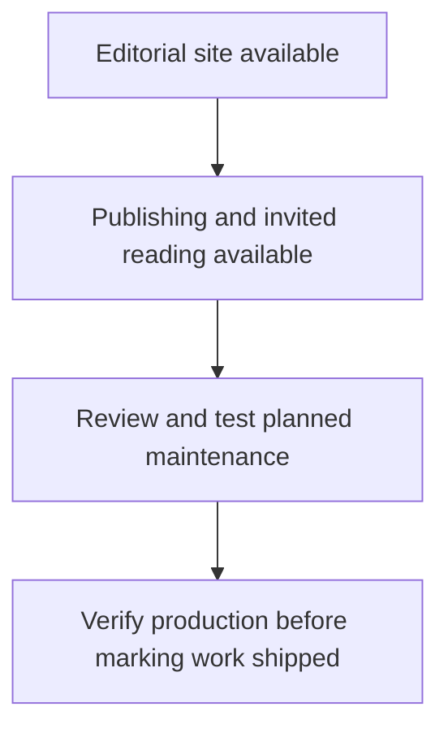

# The Harithsa Notes roadmap

The [live site](https://theharithsanotes.com/) is available to readers today. People and Journal is available to invited readers.

| Stage | Audience and outcome | Availability |
| --- | --- | --- |
| Editorial site | Readers can browse articles, books, projects and photos. | Live |
| Publishing and private reading | The author can draft and publish entries. Invited readers can open People and Journal. | Live |
| Dependency maintenance | Readers benefit from tested updates to the delivery and tooling stack. | Sprint 2, Nov 30–Dec 13, 2026 |
| Future editorial work | New sections or content are scheduled when scope is ready. | Follow the project for updates |

The public site and invitation-only reader are live. Planned maintenance goes through review and checks before release. Production verification determines when an update is marked shipped.

[Live project roadmap](https://github.com/users/theharithsa/projects/2/views/4) · [Release history](releases.md)
